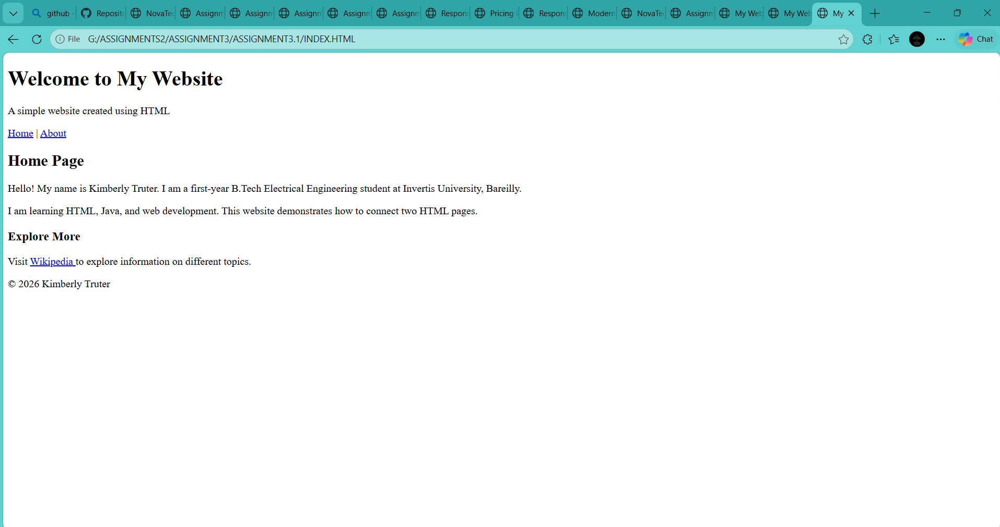
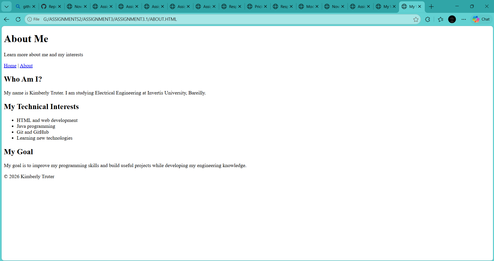

# Assignment 3.1 — Two-Page Website with Working Links

Name: Athol Ewan Shamu · Course: B.Tech Electrical Engineering · Invertis University, Bareilly

## 1. Aim

To create a simple two-page website using HTML with working navigation links between the Home and About pages and a secure external website link.

## 2. Project structure

Assignment-3.1/

`index.html`

Home

`about.html`

About

## 6. HOME PAGE

## 6. ABOUT PAGE

If this is a new repository and Git has not been connected to GitHub yet, configure the remote and upstream branch first.

## 8. Result

The two-page website demonstrates correct HTML document structure, semantic headings, internal navigation between two pages, and a secure external hyperlink using `target="_blank"` and `rel="noopener noreferrer"`.

